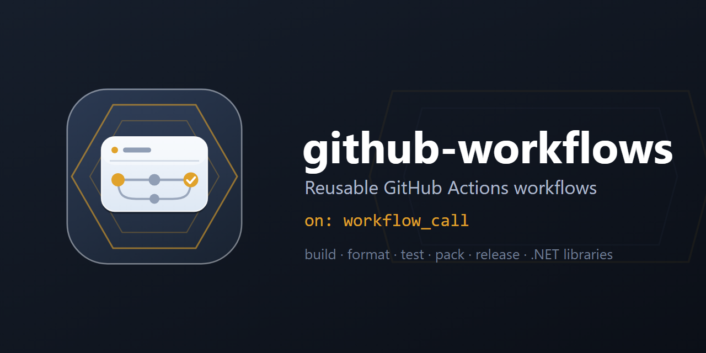

<p align="center">
  
</p>

# github-workflows

> Reusable GitHub Actions workflows for the `JorgeCostaMacia.*` .NET libraries — build, format check, test, pack and
> GitHub Releases — written once and called with `uses:` from every library repo.

[](LICENSE.txt)
[](https://github.com/JorgeCostaMacia/github-workflows/actions/workflows/release.yml)

Called by [ddd-dotnet](https://github.com/JorgeCostaMacia/ddd-dotnet),
[quartz-dotnet](https://github.com/JorgeCostaMacia/quartz-dotnet),
[serilog-dotnet](https://github.com/JorgeCostaMacia/serilog-dotnet),
[bus-net](https://github.com/JorgeCostaMacia/bus-net) and [http-net](https://github.com/JorgeCostaMacia/http-net). Public so that those public repos can call it; it is built
for them, and nothing here is supported for anyone else.

## Workflows

| Workflow | What it does |
| --- | --- |
| [dotnet-build-nuget](.github/workflows/dotnet-build-nuget.yml) | Convention guards, restore, build, format check, test and pack of a library repo, as the `nuget` artifact |
| [github-release](.github/workflows/github-release.yml) | The GitHub Release of the pushed tag, with generated notes |

Each workflow documents itself: its header says what it does, how to call it and what the calling repo needs.
`release.yml` is not one of them: it is this repository's own workflow, which creates the GitHub Release of each
`vX.Y.Z` tag.

## Calling them

A library repo keeps three small workflows. **Develop** is the gate:

```yaml
name: Develop

on:
  push:
    branches: [ "develop" ]
  pull_request:
    branches: [ "develop", "main" ]

permissions:
  contents: read

concurrency:
  group: develop-${{ github.ref }}
  cancel-in-progress: true

jobs:
  build:
    uses: JorgeCostaMacia/github-workflows/.github/workflows/dotnet-build-nuget.yml@v1
    with:
      solution: my-library.slnx
```

**Main** builds the same way and pushes the packages to nuget.org. The push is the caller's own job, because the
Trusted Publishing policy on nuget.org names the repo's `main.yml`:

```yaml
name: Main

on:
  push:
    branches: [ "main" ]

permissions:
  contents: read

concurrency:
  group: main

jobs:
  build:
    uses: JorgeCostaMacia/github-workflows/.github/workflows/dotnet-build-nuget.yml@v1
    with:
      solution: my-library.slnx

  publish:
    needs: build
    runs-on: ubuntu-latest
    permissions:
      id-token: write # the OIDC token that nuget.org exchanges for a one-hour API key
    steps:
      - name: Download nuget artifact
        uses: actions/download-artifact@v8
        with:
          name: nuget
          path: nuget
      - name: NuGet login
        uses: NuGet/login@v1
        id: login
        with:
          user: JorgeCostaMacia
      # One push for every package (the shell expands the list; each .snupkg goes with its .nupkg).
      # --skip-duplicate: a version already on nuget.org is left as it is, so a push to main that did not move the
      # version publishes nothing.
      - name: Push NuGet
        env:
          NUGET_API_KEY: ${{ steps.login.outputs.NUGET_API_KEY }}
        run: dotnet nuget push nuget/*.nupkg --api-key "$NUGET_API_KEY" --source https://api.nuget.org/v3/index.json --skip-duplicate
```

**Release** records each `v*` tag the GitFlow finish pushes:

```yaml
name: Release

on:
  push:
    tags:
      - 'v*'

permissions:
  contents: write

jobs:
  release:
    uses: JorgeCostaMacia/github-workflows/.github/workflows/github-release.yml@v1
```

## Checking

There is nothing to build: the workflows are checked with [actionlint](https://github.com/rhysd/actionlint).

```bash
docker run --rm -v "$PWD:/repo" -w /repo rhysd/actionlint:1.7.7 -no-color
```

See [CONTRIBUTING.md](CONTRIBUTING.md) for the release conventions, and [AGENTS.md](AGENTS.md) for how the repository
is put together.

## Versioning

Every release is a `vX.Y.Z` tag with its GitHub Release, and moves the major tag, `v1`, which callers pin (`@v1`): a
compatible change reaches them with no change on their side, and a breaking one gets a new major.

## Contact

- [LinkedIn](https://www.linkedin.com/in/jorge-costa-macia-842817164/)
- [GitHub](https://github.com/JorgeCostaMacia/)
- [Bitbucket](https://bitbucket.org/jorgecostamacia/)
